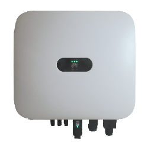

# ioBroker.fusionsolar

[](https://www.npmjs.com/package/iobroker.fusionsolar)
[](https://www.npmjs.com/package/iobroker.fusionsolar)

[](https://github.com/KornSW/ioBroker.fusionsolar/actions/workflows/test-and-release.yml)

[](https://nodei.co/npm/iobroker.fusionsolar/)

**Deutsche Anleitung: [doc/de/README.md](doc/de/README.md)**

## Huawei FusionSolar adapter for ioBroker

This adapter reads the data of your Huawei PV system (SUN2000 inverters, LUNA2000 batteries, power meters, ...) from the **Huawei FusionSolar cloud** via its official _northbound API_ and provides it as ioBroker states.

- station (plant) data: yield of the day / month / total, income, health state
- inverters: active power, AC voltages / currents, MPPT and string (PV) values, temperature, efficiency, ...
- batteries: state of charge, charge / discharge power, status, ...
- power meters: grid power (per phase), voltages, currents, imported / exported energy, ...
- optimizers and other device types can be loaded optionally

> [!NOTE]
> The data comes from the cloud, **not** directly from your inverter. Huawei refreshes it only every 5 minutes.
> If you need local real-time data (seconds instead of minutes), have a look at the Modbus based adapters
> (e.g. [ioBroker.sun2000](https://github.com/bolliy/ioBroker.sun2000)).

## Requirements

- ioBroker with js-controller >= 6.0.11 and admin >= 7.4.10
- Node.js >= 22
- a **FusionSolar northbound API account** (see below)

### The API account

The adapter does **not** work with the user name and password of the FusionSolar app or web portal!
It needs a separate _northbound API account_ (also called "Northbound management" / "third party system" account):

- **Ask your installer** - installers can create it in the FusionSolar web portal under
  _System > Company Management > Northbound Management_ (the menu names can vary slightly).
  Please make sure that the account gets access to your plant and to the "basic" API interfaces.
- or ask the **Huawei support** (Europe: `eu_inverter_support@huawei.com`).

You will get a user name and a password (called _system code_ in the API documentation).

## Installation

Install the adapter like any other adapter via the _Adapters_ tab of the ioBroker admin and create an instance.

<details>
<summary>Installing the latest development version from GitHub</summary>

1. Enable the expert mode in the ioBroker admin
2. Go to the _Adapters_ tab and click on the GitHub icon (_install from custom URL_)
3. Select the tab _custom_ and enter `https://github.com/KornSW/ioBroker.fusionsolar`
4. Press _install_ and create an instance afterwards

</details>

## Configuration

| Setting | Description |
| --- | --- |
| **API user name** / **API password** | Credentials of the northbound API account (see above). |
| **API server** | Host name of the FusionSolar server of your region. Use the host name you see in the address bar of your browser when you are logged in to the FusionSolar web portal (e.g. `eu5.fusionsolar.huawei.com`, `region01eu5.fusionsolar.huawei.com`, `intl.fusionsolar.huawei.com`). |
| **API generation** | API accounts created after 30.06.2022 must use newer interfaces (see [doc/API-GENERATIONS.md](doc/API-GENERATIONS.md)). _Automatic detection_ (default) tries the 1st generation first and falls back to the 2nd generation. Only set it explicitly if the detection does not work for you. |
| **Poll interval in seconds** | How often the data is loaded. Minimum 60, **recommended 300** (Huawei refreshes the data only every 5 minutes). |
| **Wait time between API calls in seconds** | Pause between two API calls. Increase it if you get quota errors. |
| **Retry API calls on call limit errors** | Retries a call (up to 3 times, with increasing wait times) if the API reports a call limit error (`failCode 407` or HTTP 403). |
| **Skip devices of type 'optimizer'** | Optimizers are skipped by default - loading them needs additional API calls. |
| **Skip devices of unknown type** | Devices which are not known by this adapter are skipped by default. If you disable it, all values delivered by the API are written as generic states. |

## States

The objects are created below `fusionsolar.<instance>` in the following structure:

```
fusionsolar.0
├── info.connection                  true if the last update cycle was successful
├── lastUpdate                       time of the last successful update
└── <stationCode>                    one folder per station (plant), e.g. "NE=12345678"
    ├── stationName, capacity, ...   station information
    ├── kpi.realtime                 dayPower, monthPower, totalPower, dayIncome, totalIncome, realHealthState
    └── <deviceId>                   one folder per device
        ├── devName, devTypeId, devTypeDesc, esnCode, invType, softwareVersion, ...
        ├── updatePriority           loading frequency of this device (writable, see below)
        └── kpi.realtime             realtime values of the device
```

### Realtime values per device type

| Device type (`devTypeId`) | Values (selection) |
| --- | --- |
| Inverter (`1`, `38`) | `activePower` (kW), `reactivePower`, `efficiency` (%), `temperature` (°C), `elecFreq` (Hz), `dayCap` / `totalCap` (kWh), `runState`, `inverterState`, `AC.aU` / `AC.aI` ... (per phase), `MPPT.mpptPower`, `MPPT.mppt01Cap` ..., `PV.pv01u` / `PV.pv01i` ... (per string) |
| Battery (`39`) | `batterySoc` (%), `batterySoh`, `chDischargePower` (W, positive = charging, negative = discharging), `batteryStatus`, `chargeCap` / `dischargeCap` (kWh), `maxChargePower` / `maxDischargePower` (W), `busbarU` (V) |
| Power meter (`47`) | `activePower` (W, per phase: `activePowerA/B/C`), `reactivePower`, `meterU` / `meterI`, `bU`, `cU`, ..., `gridFrequency` (Hz), `activeCap` (kWh), `reverseActiveCap` (kWh), ... |
| Dongle (`62`) | the API does not deliver realtime values for dongles |
| Optimizer (`46`) and unknown types | all values delivered by the API (only if enabled in the settings) |

> [!TIP]
> The sign of the meter's `activePower` depends on how the meter is installed. Compare it once with the
> values shown in the FusionSolar app to find out which sign means feeding into / consuming from the grid.

### Loading frequency per device (`updatePriority`)

Every device has a writable state `updatePriority` to reduce the number of API calls for devices whose values are not that important to you:

| Value | Meaning | Example with a poll interval of 300 s |
| --- | --- | --- |
| 0 | don't update (values are loaded only once after the adapter start) | - |
| 1 | every time (default) | every 5 min |
| 2 | every 2nd time | every 10 min |
| 3 | every 4th time | every 20 min |
| 4 | every 8th time | every 40 min |
| 5 | every 16th time | every 80 min |
| 6 | every 32th time | every 160 min |

Devices of the same type are loaded with one API call, so the setting saves API calls only if all devices of a type are affected.

## API limits and troubleshooting

The FusionSolar API is strictly rate limited (details: [doc/RATE-LIMITS.md](doc/RATE-LIMITS.md)). Realtime station data and realtime device data (per device type) may be requested once every 5 minutes, the station and device lists only a few times per day. Huawei also changed the API several times depending on the creation date of the API account (details: [doc/API-GENERATIONS.md](doc/API-GENERATIONS.md)). The adapter therefore

- loads the station and device lists only on start and then once a day,
- loads the realtime values of all devices of the same type with one call,
- waits between two calls (_wait time between API calls_) and
- backs off exponentially (up to 1 hour) after errors.

| Message in the log | Cause and solution |
| --- | --- |
| `Login failed ... please check user name and password` | Wrong credentials, or you are using your app / portal account instead of the API account. The adapter waits 1 hour before the next login to avoid that your account gets locked. |
| `access frequency is too high (failCode 407)` / `HTTP 403` | The API call limit was exceeded. Increase the poll interval (300 s is recommended) and / or the wait time between API calls. Don't use the same API account in several systems at the same time. |
| `no permission to use this interface (failCode 401)` | The API account has no permission for this interface, or the API generation is wrong. Try to set the _API generation_ explicitly, or ask your installer to grant the permissions. |
| `failCode 20056` | The plant owner has not (re-)authorized the API access. The **plant owner** must enable / confirm "API Access" for the plant in the FusionSolar app (required since a Huawei update in 09/2025). |
| `failCode 20003` | The validity date of the API account has expired - it can be extended in _Northbound Management_. |
| `The API did not return any station` | The API account is not assigned to your plant - ask your installer. |
| Network errors (`ECONNRESET`, `ETIMEDOUT`, ...) | Check the internet connection of your ioBroker host and the _API server_ setting. |

For a detailed analysis set the log level of the instance to `debug` - the requests and responses of the API are logged then (your password and the access token are never logged).

## Support

- Forum: [thread in the ioBroker forum](https://forum.iobroker.net/topic/59422/new-adapter-huawei-fusionsolar-api)
- Bugs and feature requests: [GitHub issues](https://github.com/KornSW/ioBroker.fusionsolar/issues)
- Rate limits and throttling: [doc/RATE-LIMITS.md](doc/RATE-LIMITS.md)
- API account generations and Huawei platform changes: [doc/API-GENERATIONS.md](doc/API-GENERATIONS.md)
- Developers: see [doc/DEVELOPMENT.md](doc/DEVELOPMENT.md)

Contributors are very welcome!

## Changelog

<!--
    Placeholder for the next version (at the beginning of the line):
    ### **WORK IN PROGRESS**
-->
### **WORK IN PROGRESS**

- (KornSW) **BREAKING:** requires Node.js >= 22, js-controller >= 6.0.11 and admin >= 7.4.10
- (KornSW) the adapter was completely reworked to improve its stability (the object ids stay the same)
- (KornSW) new admin user interface (jsonConfig)
- (KornSW) fixed "Cannot read properties of null (reading '0')" (#19, #21)
- (KornSW) residential inverters (`devTypeId` 38, e.g. SUN2000-xKTL-L1) are now supported (#14)
- (KornSW) fixed the unit of the battery power `chDischargePower` (W instead of kW) (#16)
- (KornSW) units and roles of many states were corrected
- (KornSW) the API server can be configured (for accounts outside of the 'eu5' region)
- (KornSW) the API generation is detected automatically
- (KornSW) fewer API calls: devices of the same type are loaded with one call, dongles are no longer requested, station and device lists are reloaded only once a day
- (KornSW) re-login, retries and error handling were reworked (limited retries, exponential backoff, clear log messages)
- (KornSW) the default poll interval for new instances is now 300 seconds
- (KornSW) optimizers and unknown devices (if enabled) now get all values delivered by the API

### 1.3.1

- (KornSW) Updated '@iobroker/adapter-core' to 3.2.3

### 1.3.0

- (KornSW) Version-Updates (fixing Errors from ioBroker-Bot)

### 1.2.4

- (Stolly82) API Call Limit Optimization

### 1.2.3

- (KornSW) support for new API-version

### 1.1.0

- (KornSW) Opt-in for loading data of 'optimizers' or unknown devices (to reduce api load)

### 1.0.1

- (KornSW) Wait time betw. API calls can now be configured (should help on quota problems)

### 1.0.0

- (KornSW) MVP level reached after some fixes regarding automatic async retries

### 0.3.0

- (KornSW) added device related channels (now MVP candidate)

### 0.2.0

- (KornSW) login and inverter realtime KPI now working

### 0.1.0

- (KornSW) initial version (inspired by https://github.com/Newan/ioBroker.easee - thnx to Newan!)

## License

MIT License

Copyright (c) 2022-2026 KornSW

Permission is hereby granted, free of charge, to any person obtaining a copy
of this software and associated documentation files (the "Software"), to deal
in the Software without restriction, including without limitation the rights
to use, copy, modify, merge, publish, distribute, sublicense, and/or sell
copies of the Software, and to permit persons to whom the Software is
furnished to do so, subject to the following conditions:

The above copyright notice and this permission notice shall be included in all
copies or substantial portions of the Software.

THE SOFTWARE IS PROVIDED "AS IS", WITHOUT WARRANTY OF ANY KIND, EXPRESS OR
IMPLIED, INCLUDING BUT NOT LIMITED TO THE WARRANTIES OF MERCHANTABILITY,
FITNESS FOR A PARTICULAR PURPOSE AND NONINFRINGEMENT. IN NO EVENT SHALL THE
AUTHORS OR COPYRIGHT HOLDERS BE LIABLE FOR ANY CLAIM, DAMAGES OR OTHER
LIABILITY, WHETHER IN AN ACTION OF CONTRACT, TORT OR OTHERWISE, ARISING FROM,
OUT OF OR IN CONNECTION WITH THE SOFTWARE OR THE USE OR OTHER DEALINGS IN THE
SOFTWARE.
